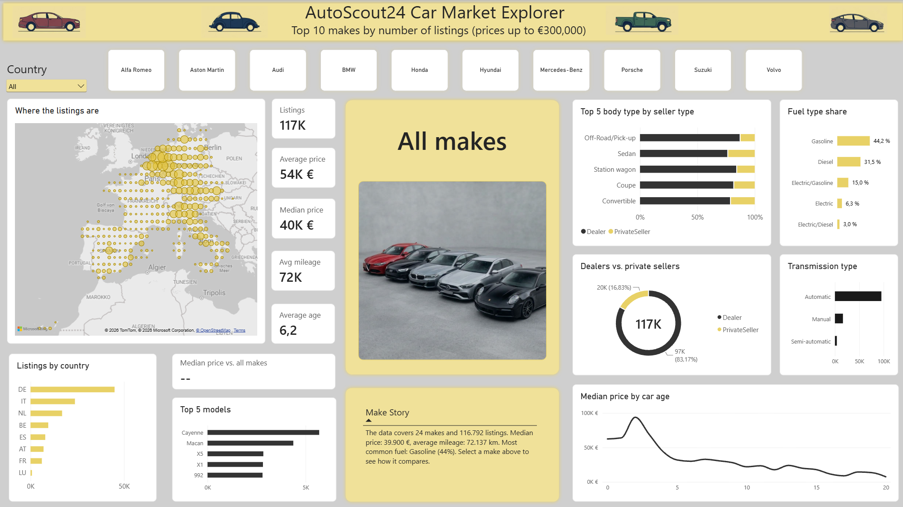

# AutoScout24 Car Market Explorer – Power BI Dashboard

🇩🇪 [Deutsche Version](README.de.md)

## Overview

An interactive Power BI dashboard built on more than 116,000 car listings from AutoScout24. Select a make and the whole page updates: key figures, price compared with all makes, body types, fuel and transmission types, dealer vs. private sellers, price by car age, a map and a text summary that rewrites itself for every selection.

This is my first Power BI project. The goal was to practise a complete analytics workflow: importing raw data, cleaning it in Power Query, building measures with DAX and designing an interactive dashboard.

## Dashboard



## Dataset

- **Source:** [AutoScout24 Car Listings Dataset on Kaggle](https://www.kaggle.com/datasets/clkmuhammed/autoscout24-car-listings-dataset) (license: MIT)
- **Raw size:** 118,382 listings, 75 columns
- **Coverage:** listings from 8 European countries (AT, BE, DE, ES, FR, IT, LU, NL), 24 makes after cleaning
- **Content:** price, make and model, mileage, registration date, fuel type, power, transmission, seller type, location, accident and service history, equipment and more

## Questions

1. What does the supply look like (listings, typical price, mileage and age)?
2. How does a single make compare with all makes?
3. How do dealers and private sellers differ?
4. What is the structure by body type, fuel type and transmission?
5. How does the price develop with the age of the car?
6. Where are the listings located?

## Dashboard Features

- **Make tiles:** the 10 makes with the most listings. One click updates every visual on the page.
- **Country filter:** drop-down to focus on one country.
- **KPI cards:** listings, average price, median price, average mileage, average age.
- **Median price vs. all makes:** shows how far the selected make is above or below the median of all makes.
- **Dynamic image and title** of the selected make.
- **"Make Story":** a text summary generated with DAX that changes for every selected make and country.
- **Charts:** map of listings, listings by country, top 5 models, body type by seller type, fuel type share, dealers vs. private sellers, transmission type, median price by car age.

## Data Cleaning (Power Query)

| Step | Rows remaining |
|---|---|
| Raw data | 118,382 |
| Removed listings without registration date | 118,161 |
| Kept registrations from 01.01.2000 onwards | 118,047 |
| Kept engine power between 30 and 1,500 hp | 118,008 |
| Removed prices below 500 EUR | 117,949 |
| Removed prices above 300,000 EUR and mileage above 500,000 km | 117,246 |
| Kept passenger cars only (removed vans) | 116,792 |

**Decisions and reasoning**

- **Removed columns:** 26 columns were dropped because they were almost or completely empty (e.g. warranty, fuel consumption in city and highway, VIN) or not relevant for the analysis (e.g. description, street, equipment lists).
- **Missing values:** only the registration date was required, because it is needed to calculate the car age. Missing engine power and mileage were kept so that the listings stay usable for other analyses.
- **Outliers:** classic and collector cars (registered before 2000) and extreme price, power and mileage values were excluded because they distort averages. For example, one BMW 316d was listed for 9.5 million EUR, which is clearly an error. Very expensive supercars were excluded on purpose, since the project focuses on the regular car market.
- **Import issue:** decimal values such as `22950.0` were first read ten times too large (`229500`) because German regional settings treat the dot as a thousands separator. This was fixed by setting the import locale to English (United States).
- **Mileage:** the column contained text such as `10,236 km`. The unit was removed and the column was converted to a whole number.
- **Currency:** all prices are in EUR.
- **Map coordinates:** some coordinates were clearly wrong (points in the Atlantic Ocean). For the map, coordinates outside Western Europe and the Canary Islands were set to empty in two new columns (`lat_map`, `lon_map`). The listings themselves were kept for all other analyses.

**New columns**

- `car_age`: age of the car in years, calculated from the registration date (reference year 2026)
- `price_group`: price brackets (under 10k, 10k–20k, 20k–40k, 40k–80k, 80k+)
- `lat_map`, `lon_map`: cleaned coordinates for the map

## DAX Measures (selection)

```
Listings     = COUNTROWS(autoscout24_clean)
Median Price = MEDIAN(autoscout24_clean[price])
Avg Mileage  = AVERAGE(autoscout24_clean[mileage_km])
Avg Age      = AVERAGE(autoscout24_clean[car_age])

Market Median Price = CALCULATE([Median Price], ALL(autoscout24_clean[make]))

Price vs Market % =
VAR _one = SELECTEDVALUE(autoscout24_clean[make])
RETURN
    IF(ISBLANK(_one), BLANK(), DIVIDE([Median Price], [Market Median Price]) - 1)

Share of Listings % =
DIVIDE([Listings], CALCULATE([Listings], ALLSELECTED(autoscout24_clean)))
```

The median price is shown next to the average because a small number of expensive cars pulls the average upwards. Further measures drive the dynamic title, image and text summary (`Selected Make`, `Make Image`, `Make Story`, `Dealer Share %`, `Top Model`, `Top Fuel`).

## Key Findings

- The dataset contains 116,792 listings from 24 makes. The median asking price is about €39,900, the average about €54,000. The average is pulled up by expensive cars, so the median is the better measure of a typical price.
- BMW, Porsche, Mercedes-Benz and Audi have the most listings. The dataset leans clearly towards premium brands.
- About 83% of all listings come from dealers and 17% from private sellers. The split differs by make: for example, 77% of BMW listings and 74% of Volvo listings come from dealers.
- Gasoline (44%) and diesel (32%) dominate. Purely electric cars make up only about 6% of listings.
- Example Volvo: median price of €16,885, which is 58% below the median of all makes. The average mileage is 163,000 km and the average age 10.9 years, compared with 72,000 km and 6.2 years across all listings.
- Example BMW: median price of about €28,000, around 30% below the median of all makes, with an average mileage of 102,000 km.
- In this sample, the median price falls sharply during the first years and flattens out after about ten years.

## Limitations

- The data shows **asking prices** of listings, not actual sales prices, and it is a snapshot of one point in time.
- The dataset covers only 24 makes and is skewed towards premium brands. Results are not representative of the whole car market.
- "All makes" in the dashboard means all makes in this dataset. "Median price vs. all makes" therefore depends on the brand mix of the sample.
- Prices from eight countries are compared directly, although price levels and taxes differ.
- Coordinates appear to be rounded to whole degrees and refer to the seller's location, so the map shows a general distribution and not exact places.
- Model names are as entered by the sellers (e.g. `992` for a Porsche 911 generation).
- Makes with few listings (e.g. Aston Martin, Honda, Hyundai) produce less reliable averages.
- The filter thresholds (year, price, mileage, power) are my own analytical decisions and influence the results.

## Credits and Disclaimer

This is an independent educational project. It is not affiliated with, endorsed by or sponsored by AutoScout24 or any car manufacturer. All brand names are the property of their respective owners. The dataset was published on Kaggle under the MIT license; the listings it contains originate from AutoScout24.

- Data: AutoScout24 Car Listings Dataset on Kaggle
- Car images and header illustrations: generated with an AI image generator. They are illustrative only and do not show the vehicles from the listings.

## Tools

Power BI Desktop, Power Query, DAX

## Author

**Karyna Yanushkevych**
[LinkedIn](https://www.linkedin.com/in/karyna-yanushkevych-91785a39a/) · [GitHub](https://github.com/yanushkevych-karyna)
